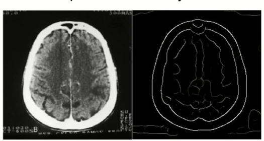
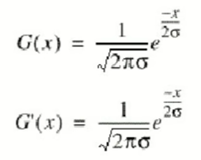

# Detecão de Bordas
Uma borda em uma imagem é uma quebra de continuidade

<a href="[https://exemplo.com](https://youtu.be/4v8Pyn45Els?si=NXD2zDSdvL7B0iYo)">Vídeo referência</a>

## O que é borda?
É o contorno entre um objeto e o fundo indicando o limite entre objetos sobrepostos. As bordas são regiões da imagem onde ocorre uma mudança de intensidade em um certo intervalo do espaço, em uma certa direção

### Como realizar a detecção?
Se pegarmos os valores da intensidade da imagem e achamos os pontos ondee a derivada é um ponto de máximo, nós teremos marcado suas bordas.
Dado que as imagens são em duas dimensões, é importante considerar mudanças nos níveis de cinza em muitas direções. Por essa razão, derivadas parciais das imagens são usadas, com as respectivas direções X e Y. Uma estimativa da direção atual da borda pode ser obtida usando as derivadas x e y como os componentes da direção ao longo dos eixos, e computar o vetor soma. O operador envolvido é o gradiente, e se a imagem é vista como uma função de duas variáveis A(x, y) então o  gradiente é definido como: 

### Um detector de borda gera:
- Uma imagem de ggradientes expreso em tons de cinza;
- Uma imagem de bordas (onde os pixel com gradientes irrelevantes foram eliminados);
- Uma matriz de vetores de orientação do gradiente (onde na posição de cada pixel está um valor indicando na posição de cada pixel está um valor indicando a direção principal do gradiente  naquele ponto)

## Operações uitlizando convolução
### Operador de Roberts
É o mais antigo e simples algoritmos de detecção de bordas. Utiliza um par de matrizes 2x2 para encontrar os gradientes nas direções x e y:

Para determinar onde o pixel avaliado é ou não um pixel de borda, o gradiente é calculado da seguinte forma:

Se a magnitude calculada é maior do que um valor limite (parâmetro), o pixel é considerado ser parte de uma borda.

A direção do gradiente da borda, perpendicular à direção da borda , é encontrada com a seguinte fórmula:

### Operador de Sobel
- Gy - acha gradientes verticais;
- Gx - acha gradientes horizontais.

Matriz transposta (A-)

- A fórmula para encontrar o gradiente e o ângulo são muito similares ao operador de Roberts.
- A computação de |G| se torna mais complexa. Na prática |G| é aproximada de seguinte forma: |G| = |Gx| + |Gy|.
- O módulo do gradiente é proporcional a derivada local da intensidade;
- O ângulo do gradiente corresponde direção de máxima variação da intensidade;
- Devido as máscaras serem 3x3 ao invés de 2x2, Sobel é muito menos sensível ao ruído do que Roberts e os resultados são mais precisos.

### Operador de Canny
Definiu um conjunto de requisitos que um detector de bordas deveria atender:
1. **Taxa de erro:** o detector de bordas deve detectar e achar somente bordas, nenhuma borda deve faltar;
2. **Localização:** a distância entre os pixels de borda encontradas pelo detector de bordas e a borda real deve ser a menor possível;
3. **Resposta:** o detector de bordas não deve identificar múltiplos pixels de borda onde somente existir um punico pixel.

O detector de bordas de Canny é um filtro de convolução f que uniformiza o ruído e localiza as bordas. O problema é identificar um filtro que otimize os três critérios do detector de bordas:
- Se consideramos uma borda de uma dimensão variando no contraste e então convolucionando a borda com a função de uniformização de Gauss, o resultado será uma variação contpinua do valor incial ao final, com uma inclinação máxima no ponto onde existe um "degrau".
- Se esta continuidade é diferenciada em relação a x, esta inclinação máxima será o máximo da nova função em relação a original.

Os máximos da convolução da máscara e da imagem indicarão bordas na imagem. Este processo pode ser realizado através do uso de uma função de Gauss de 2-Dimensões na direção de x e y. Os valores e o tamanho das máscaras de Gauss dependem da escolha do sigma (variância) na equação:

---

# Operações Diadicas

<a href="[[https://exemplo.com](https://youtu.be/4v8Pyn45Els?si=NXD2zDSdvL7B0iYo)](https://youtu.be/4UIdPigzw_8?si=vpQylT-sOibPygN2)](https://www.youtube.com/watch?v=4UIdPigzw_8&list=PLmDIGfkfgKy1SBjXA0kBk4DAhIaN1vQOS&index=3)">Vídeo referência</a>