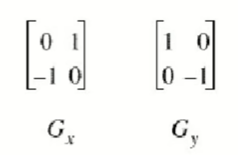
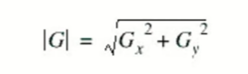
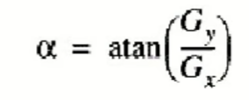
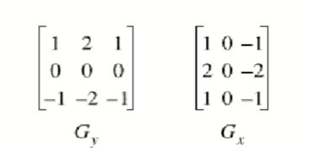

# Detecão de Bordas
Uma borda em uma imagem é uma quebra de continuidade

## O que é borda?
É o contorno entre um objeto e o fundo indicando o limite entre objetos sobrepostos. As bordas são regiões da imagem onde ocorre uma mudança de intensidade em um certo intervalo do espaço, em uma certa direção

### Como realizar a detecção?
Se pegarmos os valores da intensidade da imagem e achamos os pontos ondee a derivada é um ponto de máximo, nós teremos marcado suas bordas.
Dado que as imagens são em duas dimensões, é importante considerar mudanças nos níveis de cinza em muitas direções. Por essa razão, derivadas parciais das imagens são usadas, com as respectivas direções X e Y. Uma estimativa da direção atual da borda pode ser obtida usando as derivadas x e y como os componentes da direção ao longo dos eixos, e computar o vetor soma. O operador envolvido é o gradiente, e se a imagem é vista como uma função de duas variáveis A(x, y) então o  gradiente é definido como: 

### Um detector de borda gera:
- Uma imagem de ggradientes expreso em tons de cinza;
- Uma imagem de bordas (onde os pixel com gradientes irrelevantes foram eliminados);
- Uma matriz de vetores de orientação do gradiente (onde na posição de cada pixel está um valor indicando na posição de cada pixel está um valor indicando a direção principal do gradiente  naquele ponto)

## Operações uitlizando convolução
### Operador de Roberts
É o mais antigo e simples algoritmos de detecção de bordas. Utiliza um par de matrizes 2x2 para encontrar os gradientes nas direções x e y:

Para determinar onde o pixel avaliado é ou não um pixel de borda, o gradiente é calculado da seguinte forma:

Se a magnitude calculada é maior do que um valor limite (parâmetro), o pixel é considerado ser parte de uma borda.

A direção do gradiente da borda, perpendicular à direção da borda , é encontrada com a seguinte fórmula:

### Operador de Sobel
- Gy - acha gradientes verticais;
- Gx - acha gradientes horizontais.

Matriz transposta (A-)

- A fórmula para encontrar o gradiente e o ângulo são muito similares ao operador de Roberts.
- A computação de |G| se torna mais complexa. Na prática |G| é aproximada de seguinte forma: |G| = |Gx| + |Gy|.
- O módulo do gradiente é proporcional a derivada local da intensidade;
- O ângulo do gradiente corresponde direção de máxima variação da intensidade;
- Devido as máscaras serem 3x3 ao invés de 2x2, Sobel é muito menos sensível ao ruído do que Roberts e os resultados são mais precisos.

 