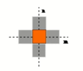
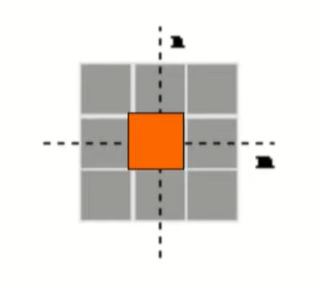
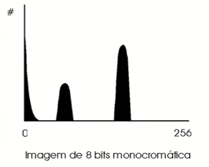

# Detecão de Bordas
Uma borda em uma imagem é uma quebra de continuidade

<a href="https://youtu.be/4v8Pyn45Els?si=NXD2zDSdvL7B0iYo">Vídeo referência</a>

## O que é borda?
É o contorno entre um objeto e o fundo indicando o limite entre objetos sobrepostos. As bordas são regiões da imagem onde ocorre uma mudança de intensidade em um certo intervalo do espaço, em uma certa direção

### Como realizar a detecção?
Se pegarmos os valores da intensidade da imagem e achamos os pontos ondee a derivada é um ponto de máximo, nós teremos marcado suas bordas.
Dado que as imagens são em duas dimensões, é importante considerar mudanças nos níveis de cinza em muitas direções. Por essa razão, derivadas parciais das imagens são usadas, com as respectivas direções X e Y. Uma estimativa da direção atual da borda pode ser obtida usando as derivadas x e y como os componentes da direção ao longo dos eixos, e computar o vetor soma. O operador envolvido é o gradiente, e se a imagem é vista como uma função de duas variáveis A(x, y) então o  gradiente é definido como: 

### Um detector de borda gera:
- Uma imagem de ggradientes expreso em tons de cinza;
- Uma imagem de bordas (onde os pixel com gradientes irrelevantes foram eliminados);
- Uma matriz de vetores de orientação do gradiente (onde na posição de cada pixel está um valor indicando na posição de cada pixel está um valor indicando a direção principal do gradiente  naquele ponto)

## Operações uitlizando convolução
### Operador de Roberts
É o mais antigo e simples algoritmos de detecção de bordas. Utiliza um par de matrizes 2x2 para encontrar os gradientes nas direções x e y:

Para determinar onde o pixel avaliado é ou não um pixel de borda, o gradiente é calculado da seguinte forma:

Se a magnitude calculada é maior do que um valor limite (parâmetro), o pixel é considerado ser parte de uma borda.

A direção do gradiente da borda, perpendicular à direção da borda , é encontrada com a seguinte fórmula:

### Operador de Sobel
- Gy - acha gradientes verticais;
- Gx - acha gradientes horizontais.

Matriz transposta (A-)

- A fórmula para encontrar o gradiente e o ângulo são muito similares ao operador de Roberts.
- A computação de |G| se torna mais complexa. Na prática |G| é aproximada de seguinte forma: |G| = |Gx| + |Gy|.
- O módulo do gradiente é proporcional a derivada local da intensidade;
- O ângulo do gradiente corresponde direção de máxima variação da intensidade;
- Devido as máscaras serem 3x3 ao invés de 2x2, Sobel é muito menos sensível ao ruído do que Roberts e os resultados são mais precisos.

### Operador de Canny
Definiu um conjunto de requisitos que um detector de bordas deveria atender:
1. **Taxa de erro:** o detector de bordas deve detectar e achar somente bordas, nenhuma borda deve faltar;
2. **Localização:** a distância entre os pixels de borda encontradas pelo detector de bordas e a borda real deve ser a menor possível;
3. **Resposta:** o detector de bordas não deve identificar múltiplos pixels de borda onde somente existir um punico pixel.

O detector de bordas de Canny é um filtro de convolução f que uniformiza o ruído e localiza as bordas. O problema é identificar um filtro que otimize os três critérios do detector de bordas:
- Se consideramos uma borda de uma dimensão variando no contraste e então convolucionando a borda com a função de uniformização de Gauss, o resultado será uma variação contpinua do valor incial ao final, com uma inclinação máxima no ponto onde existe um "degrau".
- Se esta continuidade é diferenciada em relação a x, esta inclinação máxima será o máximo da nova função em relação a original.

Os máximos da convolução da máscara e da imagem indicarão bordas na imagem. Este processo pode ser realizado através do uso de uma função de Gauss de 2-Dimensões na direção de x e y. Os valores e o tamanho das máscaras de Gauss dependem da escolha do sigma (variância) na equação:

---

# Domínios em Visão
<a href="https://www.youtube.com/watch?v=4UIdPigzw_8&list=PLmDIGfkfgKy1SBjXA0kBk4DAhIaN1vQOS&index=3">Vídeo referência</a>

## Domínio do Valor
Consideramos apenas o valor de cada pixel da imagem, sem levar em consideração o que se encontra ao seu redor.

## Domínio do Espaço
Consideramos o valor de cada pixel e também a relação deste com os valores de um conjunto de pixels na sua vizinhança.

## Domínio da Frequência
Consideramos o comportamento de variação do valor dos pixels de uma imagem em vários sentidos.

---

## Operações Matemáticas de imagem com operação escalar

### 1. Soma
Soma-se um escalar a cada pixel da imagem, aumentando sua intensidade.

### 2. Divisão inteira
Multiplica-se um escalar por cada pixel da imagem. Resultado é expresso em valor inteiro.

Obs.: Resultados de ambos os métodos são truncados para o **valor máximo** de representação de pixel no tipo de imagem.

### 3. Subtração
Subtrai-se um escalar de cada pixel da imagem, reduzindo-se sua intensidade.

### 4. Divisão Inteira
Divide-se o valor de cada pixel da imagem por um escalar. Expressa-se o resultado como inteiro.

Obs.: Resultados são expressos truncados ao **valor mínimo** de representação no tipo de imagem.

## Operações Lógicas com operando escalar
### 1. OR
Realiza-se OU logico entre cada pixel da imagem e operando binário escalar.

### 2. AND
Realiza-se E lógico entre cada pixel da imagem e operando binário escalar.

### 3. XOR
Realiza-se OU exclusivo lógico entre cada pixel da imagem e operando binário escalar.

### 4. NOT
Realiza-se a negação lógica de cada pixel da imagem.

Resultados são expressos sempre de forma binária (em nosso caso 0 ou 255).

## Operações Matemáticas de imagem com imagem

### 1. Soma
Soma-se cada pixel de uma imagem ao corespondente da outra.

### 2. Multiplicação
Multiplica-se cada pixel de uma imagem com o corespondente da outra. Resultado é expresso em valor inteiro.

### 3. Subtração
Subtrae-se de cada pixel de uma imagem do corespondente da outra. Resultado é expresso em vaor positivo.

### 4. Divisão 
Divide-se cada pixel de uma imagem pelo corespondente da outra. Resultado é exxpresso em valor inteiro

## Operações Lógicas de imagem com imagem

### 1. OR
Realiza-se OU lógico entre cada pixel corespondente das imagens.

### 2. AND
Realiza-se E lógico entre cada pixxel corepondente das imagens.

### 3. XOR
Realiza-se OU exclusivo lógico entre cada pixel corespondente das imagens.

## Operações de Limiarização

### 1. Limiar acima
Compara-se cada pixel de uma imagem com um valor limiar. Ixes cujo valor for >= ao limiar recebem a cor #1, o resto a cor #2.

### 2. Limiar abaixo
Compara-se cada pixel de uma imagem com um valor limiar. Pixels cujo valor for <= ao limiar recebem a cor #1, o resto a cor #@.

Para indicar que as cores são branco e preto, podemos expressar #1 = 255 e #2 = 0.

### 3. Limiar dentro
Compara-se cada pixel de uma imagem com dois valores limiar. Pixels cujo valor for >= ao limiar inferior e <= ao superior recebme a cor #1, o resto a cor #2.

### 4. Limiar fora
Compara-se cada pixel de uma imagem dois vaores limiar. PIxels cujo vaor for <= ao limiar inferior e >= ao superior recebem a cor #1, o resto a cor #2.

### 5. Limiar acima com histerese
Compara-se cada pixel de uma imagem com dois valores limiares. Pixels cujo valor for >= ao limiar superior recebem a cor #1, pixels que foram <= ao inferior a cor #2. Pixels entre os limiares são comparados aos seus vizinhos imediatos ( vizinhança de 4 ou vizinhança de 8), se algum vizinho estiver acima do limiar, este pixel receberá a cor #1, senão #2.

- Vizinhança de 4:
- 

- Vizinhança de 8:

## Operações Estatísticas

### 1. Histograma
Para cada possível valor de pixel na escala de valores utilizada (0 a 255 no nosso caso) conta-se o número de pixels apresentando esse valor. Gera-se um vetor contendo esses valores (256 posições no nosso caso) e também uma imagem representando essa contagem como um gráfico de barras.

### 2. Histograma por Faixas
Calcula-se o histograma dividindo-se a faixa de valores em pedaços dados por seus limites.

### 3. Pontos Nodais de Histograma
Calcula-se o histograma e procura-se por n fundos-de-vale no mesmo. Gera-se um vetor contendp esses valores.

